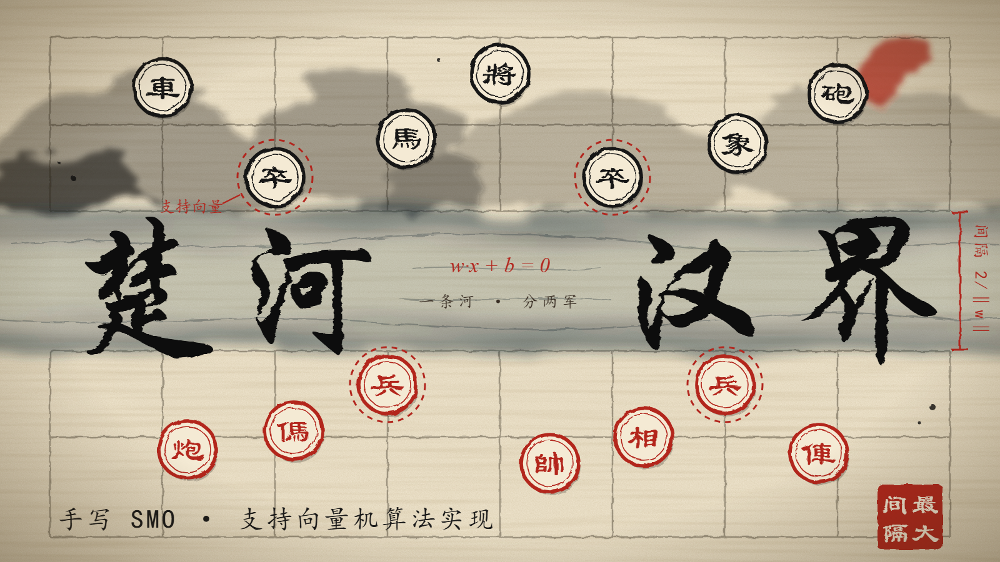
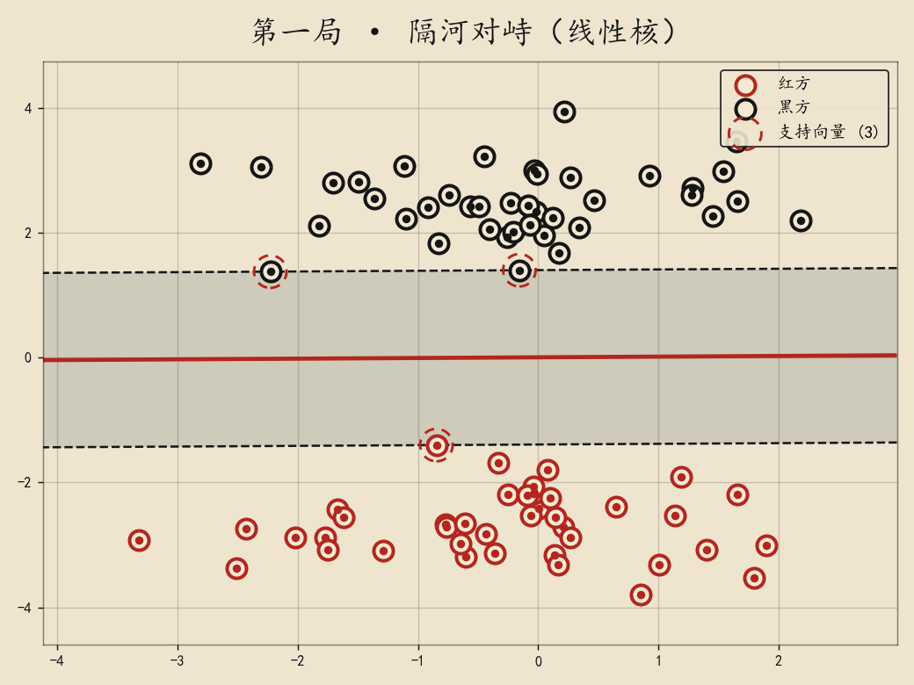
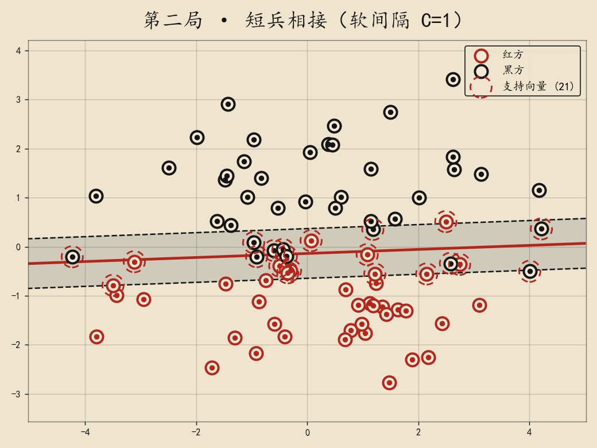
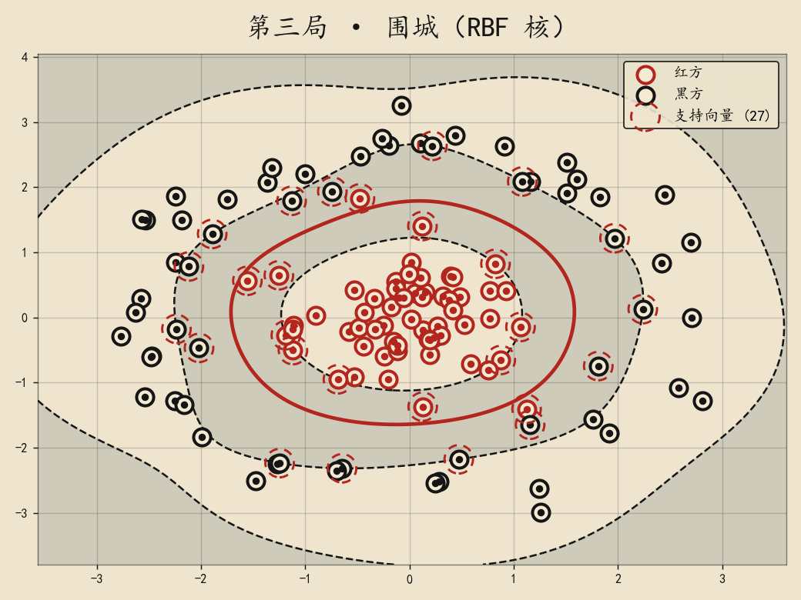

# 楚河汉界 · chuhe-svm

> 一条河，分两军。用 100 行 NumPy 手写 SMO，把支持向量机下成一盘棋。



象棋盘中间那条"楚河汉界"，就是一个再直观不过的分类器：河这边是红方，河那边是黑方。
支持向量机要回答的问题只有一个——**这条河最宽能挖多宽？**

本仓库不调用任何现成的 SVM 库，只用 NumPy 实现了：

- 软间隔 SVM 的对偶问题求解（SMO，最大违反对选择）
- 线性核 / 多项式核 / RBF 核
- 一个水墨棋盘风格的决策边界绘图函数

并且用 scikit-learn 当"裁判"核对了结果。

## 目录结构

```
chuhe-svm/
├── chuhe_svm/
│   ├── smo.py        # SVC 类：SMO 求解器（核心，约 100 行）
│   ├── kernels.py    # 线性 / 多项式 / RBF 核
│   └── board.py      # 造数据 + 画棋盘
├── examples/demo.py  # 三局棋，一键复现下面所有图和数字
├── tests/test_smo.py # 4 个测试（含教材手算例题、与 sklearn 对比）
├── assets/           # 生成的图片
└── requirements.txt
```

## 快速开始

```bash
pip install -r requirements.txt
python tests/test_smo.py
python examples/demo.py
```

```python
from chuhe_svm import SVC, make_two_armies

X, y = make_two_armies(gap=2.6, spread=0.6)
model = SVC(C=1e3, kernel="linear").fit(X, y)
print(model.coef_, model.intercept_, model.margin_)   # w, b, 河宽 2/||w||
print(model.support_)                                  # 哪几个棋子在"守河"
```

## 棋理：SMO 是怎么走子的

对偶问题：

```
max  Σ αᵢ − ½ ΣΣ αᵢαⱼ yᵢyⱼ K(xᵢ, xⱼ)
s.t. 0 ≤ αᵢ ≤ C,   Σ αᵢyᵢ = 0
```

因为有 `Σ αᵢyᵢ = 0` 这条等式约束，一次只动一个 α 是动不了的，所以 **每步动两个**：

1. **选子**：记 `Fᵢ = Σⱼ αⱼyⱼK(xᵢ,xⱼ) − yᵢ`。在"还能往上走"的棋子里挑 F 最小的 i，
   在"还能往下走"的棋子里挑 F 最大的 j —— 这是违反 KKT 条件最严重的一对。
2. **走子**：两个变量的子问题有闭式解
   `αⱼ ← αⱼ + yⱼ(Fᵢ − Fⱼ)/η`，其中 `η = Kᵢᵢ + Kⱼⱼ − 2Kᵢⱼ`，再剪回盒子 `[L, H]`。
3. **收官**：当 `max F_low − min F_up < tol`，没有哪一对值得再动，停止。
   偏置 `b` 取两者中点的相反数。

对应代码见 [`chuhe_svm/smo.py`](chuhe_svm/smo.py)。

> 踩过的坑：判断"α 是否到边"必须留一点浮点容差（代码里的 `eps`）。
> 不留的话，一个本该等于 C 却差了 1e-16 的 α 会被反复选中，算法原地打转不收敛。

## 三局棋（`python examples/demo.py` 的真实输出）

### 第一局 · 隔河对峙（线性核）

| | w | b | 支持向量 |
|---|---|---|---|
| 本仓库 | [0.0078, −0.7157] | 0.0045 | 3 个 |
| scikit-learn | [0.0075, −0.7158] | 0.0041 | 3 个 |

河宽 `2/‖w‖ = 2.794`，80 个棋子里只有 3 个在守河，其余的挪走也不影响结果。



### 第二局 · 短兵相接（软间隔，看 C）

两军有交叠，不可能完全分开。`C` 是"越线罚款"的单价：

| C | 河宽 | 支持向量 | 训练准确率 |
|---|---|---|---|
| 0.01 | 3.724 | 64 | 0.887 |
| 1 | 1.012 | 21 | 0.925 |
| 100 | 0.647 | 17 | 0.938 |

罚得越重，河挖得越窄；罚得越轻，河越宽、越多棋子泡在河里。



### 第三局 · 围城（RBF 核）

红军被黑军围在中间，任何直线都分不开：线性核训练准确率只有 0.708；
换成 RBF 核（γ=0.5）后是 0.983，与 scikit-learn 的预测 100% 一致，支持向量同为 27 个。



## 测试

```
通过 test_hand_example        # 《统计学习方法》例 7.1：解出 w=(0.5,0.5), b=-2
通过 test_kkt_and_constraint  # Σαᵢyᵢ=0，0<αᵢ≤C
通过 test_rbf_solves_siege    # 线性核分不开、RBF 核分得开
通过 test_matches_sklearn     # w、b 与 sklearn 一致
```

## 局限

- 只支持二分类；核矩阵整块放在内存里，适合几千个样本以内的教学场景。
- 没有做收缩（shrinking）和核缓存，`C` 很大时迭代次数明显多于 libsvm。

## 许可

MIT
